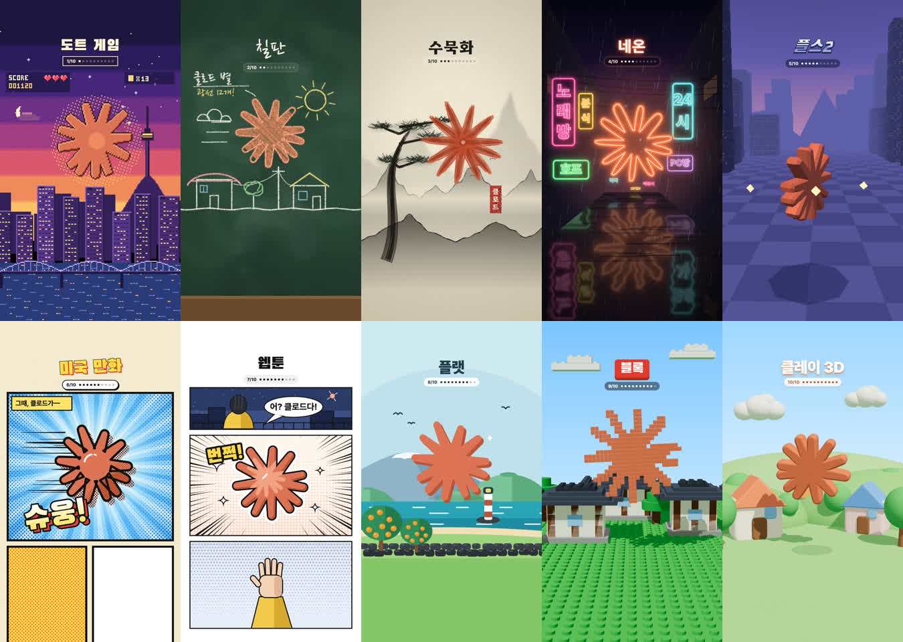

# 화풍 10개 — 클로드로 그리는 세로 영상 스킬

대본 한 줄과 화풍 하나로 1080×1920 세로 영상(릴스·쇼츠)을 **코드로** 그리는 클로드 스킬입니다. 영상 편집 프로그램은 쓰지 않습니다.



도트 게임 · 칠판 · 수묵화 · 네온 · 플스2 · 미국 만화 · 웹툰 · 플랫 · 블록 · 클레이 3D

## 설치

**가장 쉬운 방법** — 클로드 코드에 이 한 줄을 붙여 넣습니다.

```
https://github.com/worpsense/claude-art-styles 를 내 클로드 스킬 폴더(~/.claude/skills/claude-art-styles)에 설치하고 준비해 줘
```

직접 하려면:

```bash
git clone https://github.com/worpsense/claude-art-styles ~/.claude/skills/claude-art-styles
cd ~/.claude/skills/claude-art-styles
npm install
```

깃을 안 쓰면 이 페이지의 **Code → Download ZIP**으로 받아 압축을 풀고, 폴더 이름을 `claude-art-styles`로 바꿔 `~/.claude/skills/`(윈도우 `C:\Users\내이름\.claude\skills\`)에 넣습니다.

준비물: Node.js 18 이상, mp4로 뽑으려면 ffmpeg(윈도우 `winget install ffmpeg`, 맥 `brew install ffmpeg`). `npm install`이 크롬을 함께 받습니다(약 150MB).

## 쓰는 법

클로드 코드를 새로 열고 이렇게 말합니다.

```
화풍 스킬로 영상 하나 만들어 줘.
화풍: 수묵화
대본: 김이 피어오르는 커피잔이 안개 낀 산 위에 떠 있다
길이: 4초
```

클로드가 장면을 한 줄로 정리하고, 미리 보기 주소를 알려 줍니다. 마음에 들면 "mp4로 뽑아 줘" — `out/`에 1080×1920 영상(소리 없음)이 생깁니다.

직접 실행:

```bash
node scripts/render.mjs preview styles/worlds/ink.html           # 브라우저 미리 보기(반복 재생)
node scripts/render.mjs export  styles/worlds/ink.html --sec 4   # out/ink.mp4
```

## 화풍 10개

| 화풍 | 본보기 | 결 |
|---|---|---|
| 도트 게임 | `styles/worlds/pixel.html` | 16비트 게임 화면, 노을 도시, 점수판 |
| 칠판 | `chalk.html` | 분필로 그려지는 그림과 손글씨 |
| 수묵화 | `ink.html` | 한지, 먹 번짐 산, 소나무, 낙관 |
| 네온 | `neon.html` | 비 오는 밤 골목, 한글 네온 간판 |
| 플스2 | `ps2.html` | 각진 3D 도시, 안개, 도는 아이템 |
| 미국 만화 | `comic.html` | 망점, 굵은 선, 의성어 |
| 웹툰 | `webtoon.html` | 세로 칸, 집중선, 말칸 |
| 플랫 | `flat.html` | 면 색 풍경 |
| 블록 | `block.html` | 블록이 떨어져 조립되는 마을 |
| 클레이 3D | `clay.html` | 찰흙 결, 통통 튀는 주인공 |

본보기의 주인공(주황 별)은 대본에 쓴 내 주인공으로 바뀝니다. 화풍의 결(붓 털·픽셀·망점·찰흙)은 그대로 씁니다.

## 사용 조건

- 코드: MIT License(`LICENSE`). 만든 영상은 상업적으로 써도 됩니다.
- three.js: MIT(`styles/vendor/three-LICENSE`) · 글꼴: SIL Open Font License 1.1(`fonts/`)
- 본보기 속 별은 Claude 로고를 본뜬 모양입니다. 내 영상에는 내 주인공으로 바꿔 쓰세요.
- 자세한 것: `LICENSES.md`

---

만든 곳: 워프센스 · 인스타그램 [@jwon.ig](https://www.instagram.com/jwon.ig/) — 본보기 장면은 클로드가 코드로 그렸습니다.
